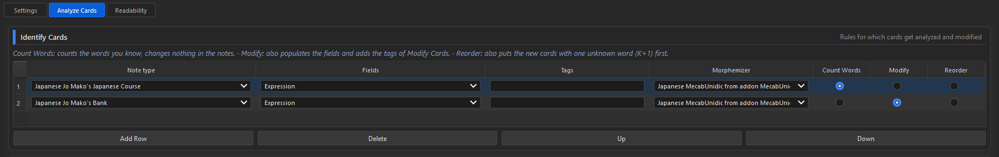
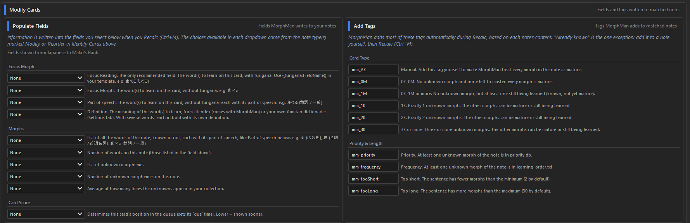
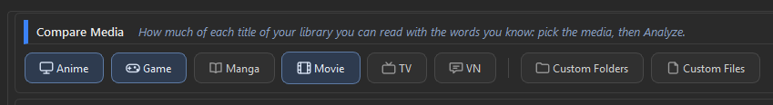
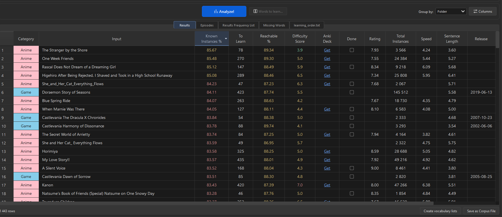
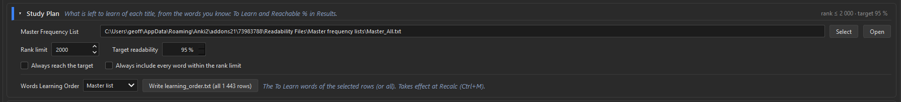

# Quick Start

The short version. Each step has its own page if you want more.

## 1. Install MorphMan

Install MorphMan (JoMako) from AnkiWeb, then restart Anki. See [Installation](installation.md).

## 2. Download the dictionary

The first time you start Anki, MorphMan asks to download MecabUnidic, the Japanese dictionary (about 500 MB).

Click yes. A small window shows a few slides while it downloads. You can keep using Anki.

When it's done, restart Anki.

If you said no, MorphMan asks again at the next start. You can also go to **Settings > Parsing** and click **Download and install**.

## 3. Tell MorphMan which cards to read

Open the **Analyze Cards** tab.

In **Identify Cards**, add a line for your Japanese note type and pick the field with the Japanese sentence.

Choose what MorphMan does with these cards:

- **Count Words**: it only learns which words you know.

Ex: A premade deck teaching you the most common vocabulary.

- **Modify**: it also fills the MorphMan fields and adds tags.

Ex: Sentence Bank, cards that can be used to find exemple for words you want to study.

- **Reorder**: same as Modify, and it also sorts your new cards.

Ex: Your study deck.

With Modify or Reorder, the **Modify Cards** section appears. 

Use  **Populate Fields** to link the fields you're interested in to those on your note type. Focus Morph or Focus Reading is at least recommended.

You can also edit the name of tags in the **Add Tags** sections. Leave the fields empty if you don't want them.

## 4. Run Recalc

Click **Recalc**, or press **Ctrl+M**.

## 5. Find media at your level

Open the **Readability** tab.

Check the media you're interested in. It can take a minute, maybe pick only one the first time. 

You will get a lot of data, but mainly:

- **Known Instances**: how much of the text already know.
- **To Learn**: how many words you need to reach your goal.
- **Difficulty Score**: how hard is each title.
- **Anki Deck**: Direct Link so you can download premade deck with all the sentences.
- **Done**: So you can filter titles you alread studied or at not interested in

## 6. Study Plan

You can filter the words you want to learn by two factors.
- **Rank Limit**: to focus on the most frequent words.
- **Target Readability**: to set a goal of how much you want to understand.

## 7. Words to Learn

Select a title in Results, then click **Words to learn…** (or double-click the row).

You get its unknown words, the most frequent first.

Select the words you want. The **Select** bar helps:

- **First rows**: the first N words.
- **Up to % known**: enough words to reach a %, for example 90 %.
- **By Count**: the words that appear at least N times.

No selection? The buttons use every word shown.

Then, 3 choices:

- **Add to deck**: makes the cards. A sentence from your own cards when there is one, with its sound and picture. Otherwise, a vocab card. See [Adding words to a deck](usage/add-to-deck.md).
- **Update learning_order.txt…**: at the next Recalc, your cards that teach these words come first.
- **Export .txt…**: saves the words as a file, to import in Anki with **File > Import**.

## What's next

- New to MorphMan? Read the [Glossary](glossary.md) first.
- Want to change the thresholds or the fields? See [Setup](setup.md).
- Something doesn't work? See [FAQ and Troubleshooting](faq.md), or ask on [Discord](https://discord.gg/J9Sw8jdkPY).
